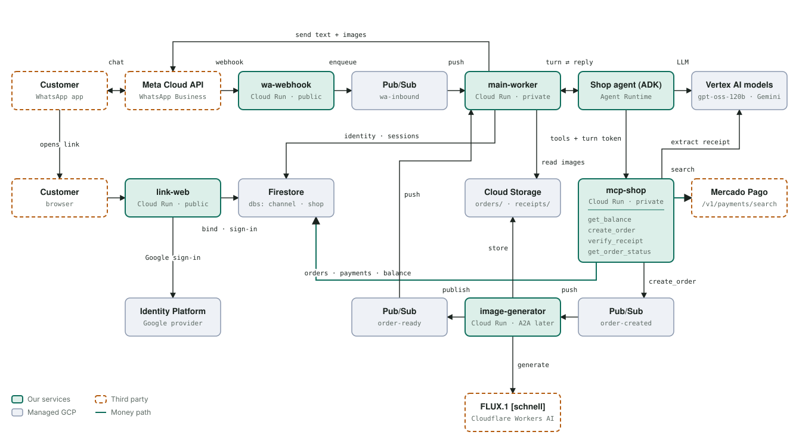

# agente-pagos-pd

A WhatsApp shop agent on Google Cloud. Customers chat in plain Spanish, order randomly generated animal images (dog, penguin, capybara) on credit, and pay their debt by bank transfer to a Mercado Pago account; the system verifies each transfer before crediting it.

It is a teaching project about **agent governance**: where an LLM agent should decide, where deterministic code must decide instead, and how identity, permissions and events keep the two apart.



## Components

| Component | Runs on | Responsibility |
|---|---|---|
| `wa-webhook` | Cloud Run, public | Verifies Meta's webhook signature, enqueues each message on `wa-inbound`, returns `200`. No business logic. |
| `main-worker` | Cloud Run, private | Consumes `wa-inbound` and `order-ready`, resolves identity and session, signs the turn token, runs one agent turn and sends the reply. Only holder of the Meta token. |
| Shop agent | Vertex AI Agent Runtime | ADK agent: understands the message, calls domain tools, writes the reply as plain text. |
| `mcp-shop` | Cloud Run, private | MCP server with the domain tools: balance, orders on credit, receipt verification against Mercado Pago. The only component that moves money. |
| `image-generator` | Cloud Run, private | Consumes `order-created`, generates the images with FLUX.1 [schnell] on Cloudflare Workers AI, stores them in Cloud Storage, publishes `order-ready`. |
| `link-web` | Cloud Run, public | One-time link page: Google sign-in through Identity Platform, binds a WhatsApp number to an account. |

## Key design decisions

- **The LLM never moves money.** The agent picks a tool; `mcp-shop` validates, reads the truth and writes the result in one transaction. Receipts are matched against Mercado Pago's own records, never against what the model or the customer claims.
- **Identity comes from a signed turn token, not from the agent.** Before every turn `main-worker` signs a 2-minute JWT (IAM `signJwt`, no stored key) with the customer id. The agent forwards it as a header; `mcp-shop` trusts only its claims. A compromised agent cannot act as another customer.
- **Tools live in a separate MCP server.** Keeping them out of the agent process keeps domain operations atomic, lets the agent's identity hold no data or secret access, and gives governance (policies, gateway, registry) a boundary to work on. The cost is one more service and one network hop per tool call.
- **Least privilege by construction.** One service account per service, Storage access limited by prefix, and two Firestore databases (`channel`, `shop`) so IAM can separate conversation data from money data. CI deploys through Workload Identity Federation with no JSON keys and no data access.
- **Event-driven delivery.** Pub/Sub decouples the public webhook from the agent and the slow image generation from the conversation. Every consumer is idempotent and every subscription has a dead-letter topic.
- **Phase 2: governance layer.** Agent Gateway and Agent Identity in front of tool calls, Model Armor on inputs and outputs, Agent Registry, policies as code and evals built from traces. Phase 1 already keeps the invariants they build on.

## Repository layout

```
libs/shared/          shared package: tokens, Pub/Sub envelope, logging, config
services/wa-webhook/  public WhatsApp webhook
services/main-worker/ conversation orchestrator
services/mcp-shop/    MCP server with the domain tools
services/image-generator/
services/link-web/    sign-in and account linking
agent/                ADK agent deployed to Agent Runtime
infra/terraform/      every GCP resource
infra/bootstrap/      one-time bootstrap (state bucket, terraform init)
docs/                 contracts and architecture diagram
.github/workflows/    CI and deploy (Workload Identity Federation)
```

## Documentation

- [SETUP.md](SETUP.md): stand the whole system up from an empty project, plus local development.
- [docs/contracts.md](docs/contracts.md): the binding contract between services (topics, tokens, MCP tools, Firestore, Storage, environment variables).

## Development

```sh
uv sync --all-packages   # one workspace: libs/shared, the five services and the agent
uv run ruff check .
uv run pytest            # every test suite in one run, as in CI
```

## Tech stack

Python 3.12, uv workspace, FastAPI, Google ADK, MCP (streamable HTTP), LiteLLM, gpt-oss-120b and Gemini on Vertex AI, Vertex AI Agent Runtime, Cloudflare Workers AI (FLUX.1 [schnell]), Cloud Run, Pub/Sub, Firestore, Cloud Storage, Secret Manager, Identity Platform, Terraform, GitHub Actions with Workload Identity Federation, WhatsApp Cloud API, Mercado Pago API.

## License

[MIT](LICENSE)
